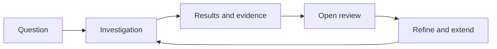

<div align="center">


# Open Research

**Research should be open to anyone with a question worth pursuing.**

[](CONTRIBUTING.md)
[](LICENSES/MIT.txt)
[](LICENSE.md)

[Explore research](#research-domains) · [Propose a problem](https://github.com/Rtx09x/Open-Research/issues/new/choose) · [Contribute](CONTRIBUTING.md) · [Review a result](VERIFICATION.md)

</div>

---

## A new way to do research

Open-source software demonstrated what people across the world could build together without belonging to the same institution, company or even discipline. What if we brought that same model to the production of knowledge?

Access to research has long depended on institutional affiliations, funding, specialised infrastructure and professional networks. Many worthwhile ideas never get investigated simply because their originators lack the means to pursue them.

AI and modern computational tools are changing what an individual or a small team can attempt. The distance between a question and a meaningful investigation is shrinking. An idea that once required an entire lab to explore may now be approachable with a laptop, accessible tools and the right collaborators. Not every barrier has disappeared, but the possibilities have expanded.

**Open Research exists to turn those possibilities into meaningful contributions to human knowledge.**

We are building an independent, collaborative research commons where curiosity can become investigation, investigation can become evidence, and evidence can become knowledge that others extend.

> Open participation. Rigorous research. Individual recognition. Collective progress.

## Find your way in

<table>
<tr>
<td width="50%">

### 🔭 Discover
Explore questions across disciplines. Find an open problem that interests you, or discover work worth extending.

</td>
<td width="50%">

### 💡 Investigate
Bring an idea, develop a method, run an experiment or pursue a proof. Share progress and evidence.

</td>
</tr>
<tr>
<td>

### 🔬 Verify
Reproduce results, challenge assumptions and identify errors. A correction is a contribution, not a failure.

</td>
<td>

### 🤝 Collaborate
Build on the work of others, exchange insights and develop solutions together, with clear credit for every substantive contribution.

</td>
</tr>
</table>

You might be a student, scientist, engineer, artist, developer or independent thinker. You might have decades of experience or be investigating your first question. **Your qualifications are not an entry requirement. The quality of your work is.**

## Research domains

| Domain | Areas of exploration |
| :--- | :--- |
| [∑ **Mathematics**](mathematics/) | Pure and applied mathematics, optimisation, information theory, numerical analysis |
| [⚛ **Physics**](physics/) | Fundamental physics, theoretical physics, quantum information |
| [◈ **Applied Physics**](applied-physics/) | Physical computing, interacting systems, programmable materials |
| [⌘ **Computer Science**](computer-science/) | Algorithms, machine learning, computation, theoretical computer science |
| [⚙ **Engineering**](engineering/) | Electrical, mechanical and systems engineering |

These are our initial domains, not the limits of the initiative. New fields and interdisciplinary questions are welcome. The first research collection is being prepared.

## The research process



Research rarely follows a straight line. Partial results, failed approaches, alternative solutions and well-founded criticism are all valuable. We welcome work at different stages, provided its claims and limitations are represented accurately.

### Open does not mean uncritical

Admission into this repository is not an endorsement of scientific correctness. Every project must document its evidence and verification status.

| Verification status | Meaning |
| :--- | :--- |
| Unverified | Preliminary work or conjecture |
| Internally verified | Substantive checks by the research team |
| Under independent review | Independent examination underway |
| Independently verified | Independent checks support specified claims |
| Peer reviewed | Relevant claims formally peer reviewed |
| Disputed | Material objections remain unresolved |

Read the [verification standards](VERIFICATION.md) for the evidence required and how statuses are updated.

### AI is a tool, not an authority

AI-assisted research is welcome. Disclose its role, document the checks performed and take responsibility for the claims you make. A generated proof, simulation or manuscript must face the same scrutiny as any other research.

### Your work remains yours

Researchers retain copyright and attribution for their original contributions, subject to the applicable open licence. Prior work must be cited, and substantive collaborators must receive appropriate credit. Git history makes contributions traceable; scholarly attribution makes their significance clear.

## Getting involved

1. **Find or propose a question.** Browse the domains or [open a research proposal](https://github.com/Rtx09x/Open-Research/issues/new/choose).
2. **Do the work.** Investigate, document and check your results, or contribute to an existing project.
3. **Share it openly.** Submit a pull request with evidence, attribution and an honest account of limitations.
4. **Keep building.** Review, reproduce, correct and extend research with other contributors.

Every project has a simple minimum structure:

```text
domain/
└── project-name/
    ├── README.md
    ├── AUTHORS.md
    ├── archive/
    └── code/
```

Beyond this, researchers decide how best to organise their work. See the [project template](templates/project/) and [contribution guidelines](CONTRIBUTING.md).

## Repository resources

| Resource | Purpose |
| :--- | :--- |
| [Contribution guidelines](CONTRIBUTING.md) | Submission requirements and research autonomy |
| [Verification standards](VERIFICATION.md) | Evidence, review and scientific accountability |
| [Governance](GOVERNANCE.md) | Maintainership and decision-making |
| [Code of conduct](CODE_OF_CONDUCT.md) | Professional and constructive collaboration |
| [Licensing](LICENSE.md) | Open reuse and contributor rights |
| [Citation](CITATION.cff) | Acknowledging the initiative |

Open Research is currently independent and founder-led, with the intention of growing into a distributed community of researchers, contributors and reviewers.

---

<div align="center">

### The next worthwhile question could come from anywhere.

**Let's find it, investigate it, and make what we learn available to everyone.**

[Start contributing](CONTRIBUTING.md) · [Open a discussion through Issues](https://github.com/Rtx09x/Open-Research/issues)

</div>
